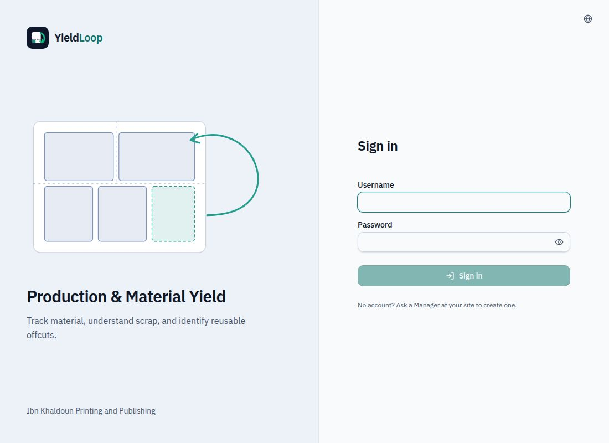
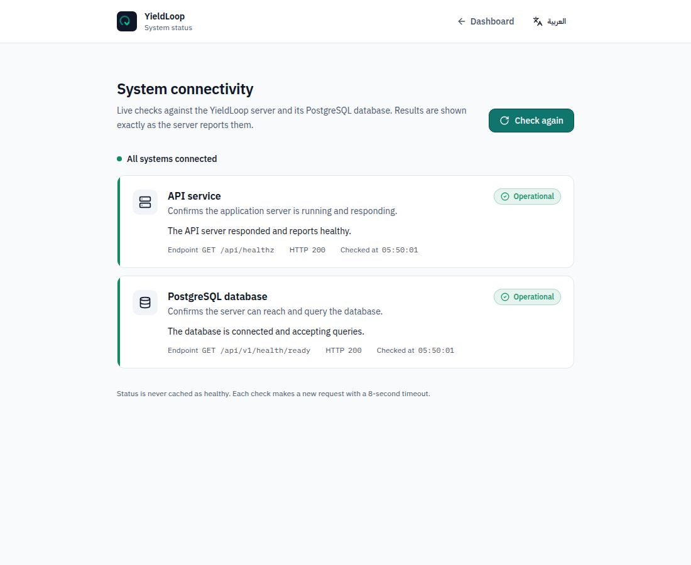

# دليل عرض YieldLoop — التطبيق الموجود فعليًا

تاريخ المراجعة: 12 أكتوبر 2026. هذا دليل شرح، وليس شهادة جاهزية إنتاج أو إعادة تنفيذ لاختبارات القبول.

## كيف تقرأ الدليل؟

- **[كود]**: ثبت وجود المسار/الزر/القاعدة في المصدر الحالي؛ ليس دليلًا على نجاح تشغيله في المتصفح.
- **[سابق]**: تفاعل ناجح موثق في `final-acceptance.md`؛ لا يعني أنه أعيد الآن.
- **[حالي]**: مشاهدة فعلية في Preview خلال إعداد هذا الدليل.
- **[غير متحقق]**: لا يوجد دليل كافٍ على التفاعل المعني، ولا يجوز عرضه كنجاح مؤكد.

تعذّر دخول الصفحات المحمية حاليًا: ملف بيانات المدير المؤقت لم يعد موجودًا بعد إعادة تشغيل البيئة. لم نخمن كلمات مرور أو نُنشئ مستخدمين. مشاهدة تسجيل الدخول والصحة حالية؛ بقية الوصف مصدره الكود والأدلة التاريخية المحددة أدناه. اختبارات الأدوار المعزولة السابقة توقفت قبل اكتمالها وليست دليل نجاح.

الأسماء العربية هنا أسماء شرح؛ عنوان الشاشة قد يتغير حسب اللغة والدور واسم السجل. أسماء الملفات والمسارات المذكورة دقيقة. `:id` معرّف سجل موجود، وليس نصًا يكتب حرفيًا.

## نطاق التحدي والإضافات

جوهر تحدي ابن خلدون هو تتبع المواد في أوامر الإنتاج، فصل الإنتاج الجيد والهدر والبواقي، تفسير أسباب الهدر المسجلة، موازنة الكميات وحساب العائد، ومقارنة IK-202 وIK-203 على CT-2. إدارة الدخول والأدوار وبيانات التخطيط تدعم تشغيل هذه الوظائف.

استوديو القص أداة تخطيط هندسي داعمة، وليس مصدر نسب العائد الوزنية ولا شرطًا لإثبات حسابات الحالتين. الذكاء الاصطناعي، والتغليف ثلاثي الأبعاد، وتحويله إلى ألواح، واستيراد/تصدير التصاميم، وتشخيص الاتصال إضافات؛ لا تُنسب إلى نص التحدي الأصلي باعتبارها متطلبات إلزامية. تتبع البواقي أساسي، أما حجزها واستهلاكها عبر أوامر أخرى فهو امتداد تشغيلي. لا توجد مرفقات مستندات خاصة جاهزة للاستخدام.

## الإطار المشترك والصلاحيات

الشريط الجانبي يعرض روابط حسب الدور، ويمكن فتح بعض الصفحات من رابط سياقي دون وجودها في القائمة. توجد أدوات اللغة، وقائمة الحساب، وتغيير كلمة المرور، والخروج؛ ولوحة مساعدة سياقية حيث يسمح الدور. القوائم قابلة للطي على الهاتف. تغيير اللغة لا يغيّر أرقام الكميات.

المشغّل يرى الأوامر المفتوحة فقط؛ المدير والمشرف يريان نطاق الأوامر الأوسع. زر مخفي ليس حماية كافية: الخادم يعيد التحقق من الصلاحية والحالة والمراجعة. خطأ عدم وجود سجل قد يعني عدم السماح برؤيته.

| الصفحة | المسار | من يمكنه الوصول وفق التنفيذ؟ |
|---|---|---|
| نقطة الدخول | `/` | الزائر إلى الدخول؛ المشغّل إلى الأوامر؛ المدير والمشرف إلى اللوحة |
| الدخول | `/login` | عام؛ المسجّل يعاد إلى صفحته الرئيسية |
| كلمة المرور | `/password` | جميع المستخدمين المسجلين؛ قد تكون إلزامية قبل بقية الصفحات |
| لوحة المتابعة | `/dashboard` | المدير والمشرف؛ المشغّل يعاد إلى الأوامر |
| أوامر الإنتاج | `/jobs` | الأدوار الثلاثة، مع نطاق رؤية المشغّل المحدود |
| أمر جديد | `/jobs/new` | المدير فقط |
| تفاصيل الأمر | `/jobs/:id` | حسب رؤية الأمر؛ الأفعال تختلف بالدور والحالة |
| اختيار أمر للقص | `/cutting` | الأدوار الثلاثة |
| استوديو القص | `/jobs/:id/cutting` | حسب رؤية الأمر؛ المشغّل للقراءة لا لحفظ التخطيط |
| مخزون البواقي | `/inventory` | الأدوار الثلاثة؛ المشغّل يرى مصادر الأوامر المفتوحة |
| تفاصيل الباقية | `/inventory/:id` | حسب نطاق المخزون؛ الحركات للمدير والمشرف |
| التقارير | `/reports` | المدير والمشرف |
| المقارنة | `/comparison` | المدير والمشرف |
| مساعد الإنتاج | `/assistant` | المدير والمشرف |
| مصمم التغليف | `/packaging` | الأدوار الثلاثة؛ ليس رابطًا رئيسيًا للمشغّل، وحفظ خطة قص يخضع لصلاحيات القص |
| الموظفون | `/employees` | المدير فقط |
| صحة الاتصال | `/health` | **عام فعليًا**؛ اقتصار رابط القائمة على المدير لا يجعل المسار خاصًا |
| غير موجود | أي مسار لا يطابق ما سبق | المسجّل يرى404؛ الزائر يمر أولًا ببوابة الدخول |

## 1. الدخول — `/login`

**الغرض:** جلسة آمنة باسم مستخدم وكلمة مرور، لا تسجيل عام ذاتي.

**العناصر:** الشعار ووصف إدارة العائد، حقل اسم المستخدم، كلمة المرور، إظهار/إخفاء الكلمة، زر الدخول، رسائل الخطأ، تبديل اللغة، وتنبيه طلب الحساب من مدير الموقع. زر الدخول معطّل عند فراغ الحقول. لا يوجد زر إنشاء حساب عام أو استعادة بريدية ذاتية في هذه الصفحة.

**صلة التحدي:** حماية العمل وربطه بالدور.

**ما أقوله:** «كل موظف يدخل بحسابه، ثم تظهر له الأدوات التي تناسب مسؤوليته، وليس جميع أدوات الإدارة.»

**الدليل:** [حالي] الصفحة والحقول وحالة الزر الفارغ والتحويل من `/`. [سابق] دخول المدير وتنفيذ سير العمل. [غير متحقق] دخول المشغّل والمشرف؛ بياناتهما المتاحة سابقًا رُفضت، والملف الحالي غير متاح.

## 2. كلمة المرور — `/password`

**العناصر:** بطاقة الحساب، الحالية أو المؤقتة، الجديدة، تأكيد الجديدة، زر الحفظ، التحقق والأخطاء وحالة الانتظار. توجد حالة خاصة بانتهاء صلاحية الكلمة المؤقتة. عند وجوب التغيير يمنع الموجّه الوصول إلى بقية الصفحات حتى استيفائه.

**صلة التحدي:** أمان إضافي داعم للأدوار، لا حساب للهدر.

**ما أقوله:** «إذا كانت كلمة المرور مؤقتة، يطلب النظام تغييرها قبل استخدام بيانات المصنع.»

**الدليل:** [كود] `pages/password.tsx` و`App.tsx` وتدفقات الحسابات. [غير متحقق] لم نغيّر كلمة مرور في هذه الجولة، ولم نختبر نموذجها حيًا.

## 3. لوحة المتابعة — `/dashboard`

**الغرض:** نظرة مجمعة للمدير والمشرف؛ العرض يتكيف مع الدور.

**العناصر الرئيسية:** عنوان وترحيب، مؤشرات الأوامر/الموازنة والكميات والعائد، اختيار المادة عند الحاجة لتفسير المقاييس، عرض حالة الإنتاج والمواد، قوائم الأوامر الحديثة وروابط التفاصيل والقص، انتقال إلى الأوامر والتقارير، مرشحات التقارير المشتركة وحالات التحميل والخطأ والفراغ. لا يُفترض أن عدم وجود قياس يعني صفرًا. لا تفسّر نسبة مجمعة على أنها متوسط بسيط للنسب.

**صلة التحدي:** متابعة الأداء والعائد والهدر.

تتضمن اللوحة رسم حالة الأوامر، ورسم توزيع المخرجات حسب المادة، ومنطقة الأوامر التي تحتاج انتباهًا؛ وزر إظهار المرشحات وروابط التقرير والمقارنة والموظفين بحسب الدور. اختيار مادة الرسم يغيّر سياق عرضه، وليس بيانات أمر إنتاج.

**ما أقوله:** «هذه نظرة عامة تساعد المشرف على معرفة أين توجد أوامر تحتاج متابعة، ثم نفتح السجل بدل الاكتفاء برقم إجمالي.»

**الدليل:** [كود] `DashboardPage` داخل `pages/reports.tsx`؛ لا يوجد ملف مستقل باسم dashboard. [سابق] التنقل المديرّي موثق؛ [غير متحقق] جميع بطاقات اللوحة وتفاعلات مرشحاتها لم تُفحص مجددًا هنا.

## 4. قائمة الأوامر — `/jobs`

**العناصر:** بحث، مرشح الحالة، عدد النتائج، صفحات النتائج، حالة الفراغ ومسح المرشحات وإعادة المحاولة، قائمة/جدول رقم الأمر واسمه وحالته ومنشئه وتحديثه، فتح التفاصيل، تسجيل المواد حيث يسمح، والانتقال للقص. «أمر جديد» للمدير فقط. تختلف طريقة عرض الصفوف على الهاتف.

**صلة التحدي:** مدخل متابعة أوامر الإنتاج.

**ما أقوله:** «أبحث عن أمر الإنتاج من هنا. المشغّل يرى العمل المفتوح، بينما يستطيع المدير والمشرف متابعة الأوامر عبر حالاتها.»

**الدليل:** [سابق] فتح القائمة، بحث فارغ، ومسح المرشحات. [كود] قيود الدور؛ ليس هناك اختبار دخول مشغّل ناجح يسمح بادعاء مشاهدة قائمته حيًا.

## 5. إنشاء أمر — `/jobs/new`

**العناصر:** عودة/إلغاء، اسم الأمر الإلزامي، ملاحظات، مواصفة المنتج، عرض وارتفاع الورقة ووحدة صريحة mm/cm/in، العائد الجيد المخطط، تعليمات القص، أخطاء الإدخال، وزر إنشاء مسودة. بيانات التخطيط اختيارية؛ أبعاد الورقة إن أُدخلت تحتاج بعدين موجبين ووحدة. المخطط 0–100% وليس العائد الفعلي أو استغلال مساحة اللوح.

**صلة التحدي:** بطاقة تشغيل تدعم تسجيل الإنتاج؛ لا نخترع مواصفات للحالتين المرجعيتين.

**ما أقوله:** «المدير يجهز بطاقة الأمر هنا. العائد المخطط هدف، أما العائد الفعلي فيُحسب من المواد المسجلة لاحقًا.»

**الدليل:** [سابق] إنشاء QA17 من الواجهة وحفظ 210×297 mm وعائد82.5% وإعادة الفتح. [كود/اختبارات] التحقق من الأبعاد. [غير متحقق] لا إنشاء أو تعديل الآن.

## 6. تفاصيل الأمر — `/jobs/:id`

**أعلى الصفحة:** رقم/اسم الأمر، الحالة والمراجعة، العودة، روابط القص والمخزون/المساعدة بحسب الصلاحية؛ فتح المسودة، إلغاء أو إكمال حسب الدور والحالة، ونوافذ تأكيد.

**بطاقة الأمر:** المرجع، الآلة، الاسم والملاحظات، مواصفة المنتج والأبعاد والوحدة والعائد المخطط وتعليمات القص؛ حفظ/تجاهل، تنبيه تعديل متزامن أو مراجعة قديمة. المدير يحرر التخطيط والمرجع في Draft/Open. المشرف يحرر ملاحظات Open، والمشرف والمشغّل يحددان الآلة في Open. المدير وحده يحرر الاسم. تغيير الآلة ليس إنشاء دليل آلات مركزيًا.

**المواد والموازنة:** اختيار المادة وتعريفها حيث يسمح، عرض المدخلات والجيد والهدر والبواقي وإعادة التشغيل والمجموع والفرق والنسب، توزيع كميات، تنبيه فرق موقّع، قائمة سجلات بتواريخ/أنواع/كميات/أسباب وملاحظات، ترقيم الصفحات. نموذج إضافة سجل يحدد النوع والكمية؛ سبب الهدر منفصل عن الملاحظة. توجد إجراءات إبطال بسَبب، حل إعادة التشغيل، وتسجيل الباقية في المخزون حيث تسمح الصلاحيات. لا تُحذف السجلات تاريخيًا لإخفاء التصحيح.

**قيود مهمة:** التسجيل للأدوار الثلاثة في Open. الإكمال يتطلب توازنًا دقيقًا، كميات مدخلة وجيدة موجبة، وعدم وجود إعادة تشغيل معلقة. المشرف يستطيع فتح Draft وإكمال Open؛ المشغّل يكمل Open المتوازن؛ الإلغاء للمدير. Completed/Cancelled لا تصبح قابلة للتحرير لمجرد امتلاك دور أعلى.

**الروابط العميقة:** `?entry=34#entry-34` يعثر على صفحة السجل ويبرزه. السجل المفقود يعرض رسالة خاصة وزر «عرض جميع سجلات المواد»، لا يدّعي أن الأمر كله مفقود.

**صلة التحدي:** مركز تسجيل المواد وحساب الفاقد والعائد وأسباب الهدر.

**ما أقوله:** «هذه الصفحة تربط الكميات بأمر واحد. البواقي ليست هدرًا، والفرق غير الصفري يمنع الإغلاق بدل أن نخفيه بتعديل الأرقام.»

**الدليل:** [سابق] حفظ/فتح QA17، إصدار100، جيد70 ثم حل10 من إعادة التشغيل إلى جيد، هدر10 وبواقي10، إكمال80/10/10؛ منع إغلاق QA18 غير المتوازن. الروابط ورسالة السجل المفقود وإصلاحها اختبرت EN/AR. سبب الهدر اختُبر لاحقًا بسجل QA منفصل؛ أول تجربة وضعت النص في الملاحظة لا السبب. [غير متحقق] لا أفعال جديدة الآن.

## 7. مدخل القص — `/cutting`

**العناصر:** تعريف الاستوديو، اختيار/بحث أوامر مسموحة وروابط فتح استوديو كل أمر؛ حالات الفراغ والخطأ. ليس شاشة مستقلة لإضافة قيود مخزون أو وزن.

**صلة التحدي:** أداة تخطيط داعمة، لا أساس حساب العائد الوزني.

**ما أقوله:** «أختار الأمر أولًا حتى تبقى خطة القص مرتبطة بالعمل الصحيح.»

**الدليل:** [كود] `pages/cutting-entry.tsx`؛ [غير متحقق] لم يُفتح في الجولة الحالية.

## 8. استوديو القص — `/jobs/:id/cutting`

**الوصول:** المدير يكتب في Draft/Open؛ المشرف يكتب في Open؛ المشغّل يقرأ ما يسمح نطاق الأمر برؤيته. الأوامر المغلقة للقراءة.

**العناصر:** رجوع للأمر، حالته وتحذير القراءة فقط، قائمة خطط وزر خطة جديدة، اسم الخطة، مدخلات اللوح والمادة وهوامش القص وعرض القطع kerf، قائمة قطع مستطيلة بأبعادها وكمياتها والسماح بالتدوير، السيناريو الأساسي والتحسين/التقييم، حفظ وإعادة تحميل وتاريخ المراجعات، مقارنة السيناريوهات. مساحة SVG بألسنة الألواح، تحديد قطعة وإحداثياتها، تدوير وإزالة موضع وإعادة تعيين؛ سحب ومفاتيح أسهم حيث يسمح التحرير، نتائج استغلال المساحة والقطع غير الموضوعة وتحذيرات الحدود والتداخل والهوامش والـkerf. تظهر أدوات التأكيد/التجاهل والتعارض عند الحاجة.

**حدود الشرح:** حفظ تخطيط ليس أمر تشغيل ماكينة ولا ضمان أفضل حل عالمي. نسبة المساحة لا تساوي نسبة الجيد بالكيلوغرام. لا تُطبّق تغييرات وهمية عند فشل التحقق الخادمي.

**ما أقوله:** «نرتب القطع هندسيًا داخل اللوح ونقارن استغلال المساحة. هذه نتيجة تخطيط، أما وزن الإنتاج الفعلي فيبقى في سجل المواد.»

**الدليل:** [كود] `cutting-studio.tsx` ومكونات `components/cutting/` و`cutting/views.py`. توجد أدلة قبول تاريخية للقص في التقرير؛ [غير متحقق] لا إعادة سحب أو حفظ أو لمس جديدة في هذا الدليل.

## 9. مخزون البواقي — `/inventory`

**العناصر:** بحث، مرشح المتاح/المبطل/الكل، مرشح مصدر الأمر عند تمريره وإزالته، عدد النتائج، ترقيم صفحات، صفوف البواقي بالمادة والكمية والحالة والمصدر، فتح التفاصيل، مسح مرشحات، إعادة محاولة وحالة فراغ. التسجيل يبدأ من سجل الباقية في الأمر، لا من اختراع كمية مخزون مستقلة.

**صلة التحدي:** الاحتفاظ بالبواقي القابلة لإعادة الاستخدام بدل عدها هدرًا.

**ما أقوله:** «هذه كميات نعرف مصدرها ويمكن تتبعها؛ وجودها في المخزون لا يعني تلقائيًا أنها مناسبة لأي أمر جديد.»

**الدليل:** [كود/اختبارات سابقة] المصدر والصلاحيات والموازنة؛ [غير متحقق] لم تُفتح القائمة حيًا الآن.

## 10. تفاصيل الباقية — `/inventory/:id`

**العناصر:** المادة والمواصفة، الكمية الأصلية والمتبقية والمحجوزة والمتاحة، حالة المصدر، روابط الأمر والسجل، تاريخ الحركات والأحداث والمراجعة. الحجز/فك الحجز/الاستهلاك للمدير والمشرف وفق الأرصدة؛ نوافذ تحدد الأمر والكمية والسبب وتؤكد العملية. الإبطال يتطلب صلاحية وسببًا وتأكيدًا؛ تحكمه حالة المصدر والحركات السابقة.

الاستهلاك مرتبط بحجز وبأمر متوافق ومفتوح، ويضيف إدخال مادة للأمر ضمن معاملة محمية. فحص تطابق المادة ليس إثبات ملاءمة هندسية أو جودة للقطعة؛ تظهر الملاءمة غير متحققة. المشغّل لا يملك إجراءات الحجز والاستهلاك الإدارية.

**صلة التحدي:** تتبع البواقي أساسي؛ الحجز والاستهلاك بين الأوامر امتداد.

**ما أقوله:** «أستطيع تتبع الباقية من مصدرها إلى الاستخدام اللاحق، مع منع استهلاك أكثر مما هو متاح؛ الملاءمة الفنية تحتاج حكم المصنع.»

**الدليل:** [كود] `inventory/services.py` و`movements.py`، وواجهة التفاصيل. [غير متحقق] لم ننفذ حركة مخزون في هذه الجولة.

## 11. التقارير — `/reports`

**العناصر:** مرشحات تاريخ/حالة/مادة، تطبيق/مسح، شرح أساس التاريخ، مؤشرات الكميات والنسب، مجموعات النتائج وجدول الأوامر وروابطها وترقيم الصفحات، الأخطاء وإعادة المحاولة، قياسات غير متاحة عند غياب أساس الحساب.

يشمل نموذج المرشحات تاريخ البداية والنهاية والمنطقة الزمنية، واختيار المادة أو إزالتها، وعدد الأوامر المقاسة وغير المقاسة، ورابط الانتقال إلى المقارنة.

التواريخ تختار الأوامر بحسب **تاريخ إنشائها**، ثم تستخدم أحدث قياس لها، بما فيه التصحيح اللاحق. ليست فلترة تاريخ كل حركة مادة ولا تاريخ إغلاق الأمر. لا تجمع مواد مختلفة بما يوحي بمقارنة متجانسة.

**صلة التحدي:** متابعة العائد والهدر ببيانات قابلة للتفسير.

**ما أقوله:** «أحدد مجموعة الأوامر ثم أقرأ أحدث نتائجها؛ التاريخ هنا تاريخ إنشاء الأمر، وليس بالضرورة يوم تنفيذ القص.»

**الدليل:** [سابق] وصول المدير وشرح التاريخ EN/AR. [كود/اختبارات] منع المشغّل في الخادم والواجهة. [غير متحقق] جلسة مشرف ناجحة وتفاعل جميع المرشحات الآن.

## 12. المقارنة — `/comparison`

**العناصر:** اختيار أمر A وأمر B؛ يمكن استخدام `?left=10&right=11`. عرض المرجع والآلة والمادة والحالة، جدول الكميات والنسب وفروق A−B، تنبيهات عدم التوافق، أسباب الهدر وكمياتها وسجلات مصدر قابلة للفتح. الجدول يمرّر أفقيًا داخل حاويته على الهاتف.

**الأرقام التي يمكن قولها، استنادًا إلى الاختبار السابق:**

| القياس | IK-202 | IK-203 |
|---|---:|---:|
| المدخل |1200 كغ|1000 كغ|
| الجيد |900|820|
| الهدر |240|100|
| البواقي |60|80|
| المحسوب / الفرق |1200 / 0|1000 / 0|
| عائد الجيد |75%|82%|
| الهدر |20%|10%|
| البواقي |5%|8%|

كلاهما CT-2. الفرق: +140كغ هدر، −7 نقاط مئوية للعائد، +10 للهدر، −3 للبواقي. أكبر سبب مسجل في IK-202: Setup/layout بمقدار180كغ، ثم تلف المادة60كغ. أسباب IK-203 غير محددة؛ لا ننسب له توزيعًا مخترعًا.

**صلة التحدي:** لبّ المقارنة المرجعية.

**ما أقوله:** «IK-202 فقد نسبة أكبر كهدر. أكبر فئة مسجلة فيه هي الإعداد والتخطيط، لكن الأرقام وحدها لا تثبت سببًا تشغيليًا خفيًا.»

**الدليل:** [سابق] الأرقام والروابط والتوافق اختبرت بالمتصفح. اختلاف الآلة أو المادة منع الفروق المضللة. [غير متحقق] إعادة فتحها الآن متعذرة دون دخول.

## 13. مساعد الإنتاج — `/assistant` ولوحة المساعدة السياقية

**العناصر:** بحث/اختيار أمر، حالة عدم الاختيار، بطاقة ملخص وروابط الأمر، زر سؤال المساعد حيث يسمح، لوحة أدلة موسومة بأنها ليست AI، نتائج حسابية وتعريفات النسب وأكبر فئة هدر، جدول حقائق المصدر مع معرّفاتها وإبطالها، سياق خطط القص وحدود البيانات. لوحة السؤال تعرض إدخال السؤال والرد/الانتظار والخطأ وعدم توفر المزود والمراجع؛ ظهور جواب يعتمد على الخدمة الفعلية.

**هل يوجد AI حقيقي في الكود؟ نعم:** `assistance/provider.py` ينفذ طلب خادمي إلى `https://api.openai.com/v1/chat/completions`، باستخدام مفتاح على الخادم، ورد JSON محدود الحجم والوقت، مع أخطاء صريحة وعدم وجود جواب بديل مزيف. `advisory.py` يتحقق من المخرجات وربطها بالأدلة، وتُراجع الصلاحية بعد الاستدعاء أيضًا. حساب النسب وعرض الحقائق ليس استدعاء AI.

**هل ثبت جواب حي ناجح؟ لا.** آخر دليل القبول لا يثبت استجابة مزود حية؛ الاختبارات المحاكية تختبر التحقق والأخطاء فقط. في الجولة الحالية أعاد `/api/v1/assistance/status` حالة401 لغياب الجلسة؛ لا يثبت ذلك توفر المفتاح أو غيابه الآن. حتى `available=true`، إن ظهر مستقبلًا، يدل على الإعداد لا نجاح طلب حي. لم نستدعِ خدمة مدفوعة.

**صلة التحدي:** إضافة مساعدة لشرح الأدلة، ليست شرطًا لحسابات التحدي ولا إثباتًا لسبب الهدر.

**ما أقوله:** «الحقائق هنا من سجلات النظام. يوجد ربط فعلي بمزود ذكاء اصطناعي في الكود، لكن لا أدّعي أن ردًا حيًا ناجحًا تم التحقق منه في هذه البيئة.»

**الدليل:** [كود] مسار المزود والتحقق. [حالي]401 دون جلسة. [غير متحقق] رد AI حي ناجح.

## 14. مصمم التغليف — `/packaging`

**العناصر:** شارة مفهوم تصوري، اختيار قالب tray/lid_box/sleeve، اسم التصميم، طول وعرض وارتفاع وسماكة، وارتفاع غطاء وخلوص للقالب المناسب؛ حالة تجميع/فتح بحسب القالب. زر تحقق، أخطاء الأبعاد، معاينة حية مقابل متحققة، تنبيه قدم المعاينة، نموذج ثلاثي الأبعاد أو حالة عدم توفره، وملخص هندسي.

توجد أدوات استيراد/تصدير JSON، حفظ/فتح تصميم مرتبط بأمر ومراجعة وفصل التعديل عن المحفوظ، وقائمة التصاميم. التحويل إلى القص يختار أمرًا ومادة ويولد **ألواحًا مستطيلة منفصلة** وفق قواعد panel kit. أفعال الحفظ المرتبطة بخطة تخضع لصلاحيات الأمر/القص؛ دخول المشغّل الصفحة لا يمنحه كتابة الخطط. اقتراح AI يظهر فقط عندما تسمح حالة المزود والدور؛ ليس شرطًا للاستخدام اليدوي.

**الحدود:** ليس فردة كرتون موحدة بمفاصل وثنيات محسوبة صناعيًا، ولا اعتمادًا للتصنيع أو تعويضًا عن السماحات الهندسية واختبار المادة. استيراد JSON ليس رفع مستندات خاصًا.

**صلة التحدي:** إضافة اختيارية؛ لا تتوقف صحة التحدي المرجعي عليها.

**ما أقوله:** «هذه أداة تصور وتجهيز ألواح منفصلة للقص، وليست وعدًا بفردة تصنيع نهائية. نفصل صحة الشكل عن اعتماد طريقة تصنيع الصندوق.»

**الدليل:** [كود/اختبارات] القوالب والتحقق والتحويل. [سابق] التقرير يوثق WebGL2 عبر Chromium/SwiftShader مستقل، وتغير أبعاد ثم حفظ/إعادة فتح. [غير متحقق] توفر WebGL والتفاعل في المتصفح الحالي؛ لا نعمم نجاح المتصفح السابق على كل جهاز.

## 15. الموظفون — `/employees`

**العناصر:** قائمة الموظفين وهوياتهم وأدوارهم وحالتهم، إنشاء موظف باسم مستخدم واسمين اختياريين ودور وكلمة مؤقتة، تغيير الدور مع تأكيد، تفعيل/تعطيل مع ضوابط، إعادة تعيين كلمة مؤقتة في نافذة منفصلة، حالات انتظار/خطأ. توجد حماية من بعض تغييرات المدير على نفسه، والخادم هو صاحب القرار النهائي.

**صلة التحدي:** إدارة أدوار داعمة، لا مقياس إنتاج.

**ما أقوله:** «إدارة الحسابات للمدير فقط. في العرض لن أغير أي موظف أو كلمة مرور لأن هذه تغييرات فعلية وليست أزرارًا تجريبية.»

**الدليل:** [كود/اختبارات الحسابات السابقة]؛ [غير متحقق] لم تُفتح أو تنفذ إجراءاتها الآن.

## 16. صحة الاتصال — `/health`

**العناصر الفعلية:** رابط العودة، تبديل اللغة، «Check again»، خلاصة الاتصال، بطاقة خدمة API وبطاقة PostgreSQL، الحالة والوصف والمسار ورمزHTTP ووقت الفحص؛ إعادة المحاولة عند الحاجة. الفحص `/api/healthz` و`/api/v1/health/ready`.

**الوصول:** عام رغم أن رابط القائمة مرتبط بالمدير. لا يختبر صفحة التقارير أو استرجاع النسخ الاحتياطية أو نجاح AI.

**صلة التحدي:** أداة تشخيص إضافية.

**ما أقوله:** «هذه الصفحة تؤكد أن الخدمة وقاعدة البيانات تستجيبان الآن، وليست شهادة بأن جميع وظائف النظام أو خطة التعافي جاهزة.»

**الدليل:** [حالي] البطاقتان Operational وHTTP200. لم نضغط أزرار إعادة الفحص في اختبار المتصفح؛ التحميل نفسه نفّذ فحص القراءة.

## 17. المسار الرئيسي والمنع و404

`/` ليس صفحة أعمال مستقلة: يوجه المستخدم حسب الجلسة والدور. `/login` للمسجل يعيد إلى الصفحة الرئيسية، واشتراط تغيير كلمة المرور يسبق ذلك.

المسار المعروف غير المسموح يعرض منع الوصول وزر العودة، مع استثناء تحويل المشغّل من لوحة المتابعة إلى الأوامر. المسار غير المعروف يعرض404 ورسالة ورابط الرئيسية **بعد بوابة الجلسة**؛ لا تخلط ذلك مع404 من API لسجل مفقود/مخفي أو401 لمستخدم غير مسجل. حالة فشل جلب الجلسة لها شاشة إعادة محاولة، لا مجرد تسجيل خروج مفترض.

**ما أقوله:** «النظام يميز بين عدم الدخول، وعدم الصلاحية، وعدم وجود السجل؛ لا نحاول تجاوز هذه الرسائل لتكملة العرض.»

**الدليل:** [كود] `App.tsx` و`not-found.tsx`. [حالي] تحويل الزائر من `/` إلى الدخول. [غير متحقق] شاشة404 المحمية والمنع بحسابات الأدوار في هذه الجولة.

## تسلسل عرض قصير وآمن

1. الدخول بحساب معتمد موجود، دون إظهار كلمة المرور.
2. قائمة الأوامر ثم IK-202: بطاقة الأمر، الكميات، الموازنة وأسباب الهدر.
3. IK-203 ثم المقارنة؛ اشرح الفروق بالنقاط المئوية ولا تخترع أسبابًا.
4. افتح سجل مصدر من المقارنة، ثم التقارير واشرح معنى التاريخ.
5. اعرض المخزون والقص كأدوات داعمة؛ التغليف وAI إضافتان وحدودهما واضحة.
6. لا تضغط إنشاء/حفظ/إبطال/إكمال/حجز/استهلاك/إعادة تعيين أثناء عرض السجلات الحقيقية.

حساب المدير المتاح سابقًا يحتاج الآن وسيلة دخول معتمدة لأن الملف المؤقت مفقود؛ لا يقتضي ذلك تلقائيًا إعادة تعيين كلمة المرور. سجلات QA-E2E المحتفظ بها من اختبار سابق ليست بيانات مصنع، وبعضها غير متوازن عمدًا.

## فهرس الأدلة وحدود التسليم

- الموجّه والصلاحيات: `artifacts/yieldloop/src/App.tsx`، `lib/role-access.ts`.
- شاشات العرض: `src/pages/`؛ اللوحة والتقارير في `reports.tsx`.
- التفاصيل المتداخلة: `components/materials/`، `components/cutting/`، ومكونات التغليف والمساعد.
- سلطة الخادم: `backend/jobs/policy.py`، `cutting/views.py`، `inventory/services.py` و`movements.py`، `reports/views.py`، `assistance/views.py` و`provider.py`.
- الدليل التاريخي: `docs/final-acceptance.md` و`docs/job-card-completion.md`. لم نعد تشغيل مجموعات الاختبار؛ لا ننسب نتائجها لهذه الجولة.
- الصور المضمنة صور حقيقية للصفحات العامة فقط. لم تُخترع صور للشاشات المحمية ولم تُدرج بيانات حسابات.
- لم يتغير كود التطبيق أو المستخدمون أو الأدوار أو كلمات المرور أو سجلات Preview أو المخطط أو النشر لإعداد الدليل.
- القبول السابق للعرض كان **READY WITH DOCUMENTED LIMITATIONS**؛ لا يعد هذا الدليل إغلاقًا لعوائق الدخول الحالية أو اعتماد إنتاج. جاهزية الإنتاج ما زالت منفصلة عن نجاح عرض التحدي.
